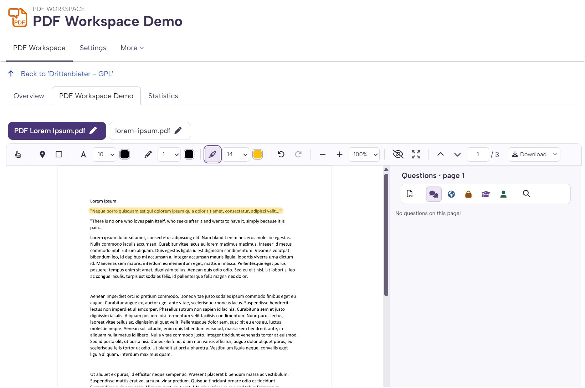
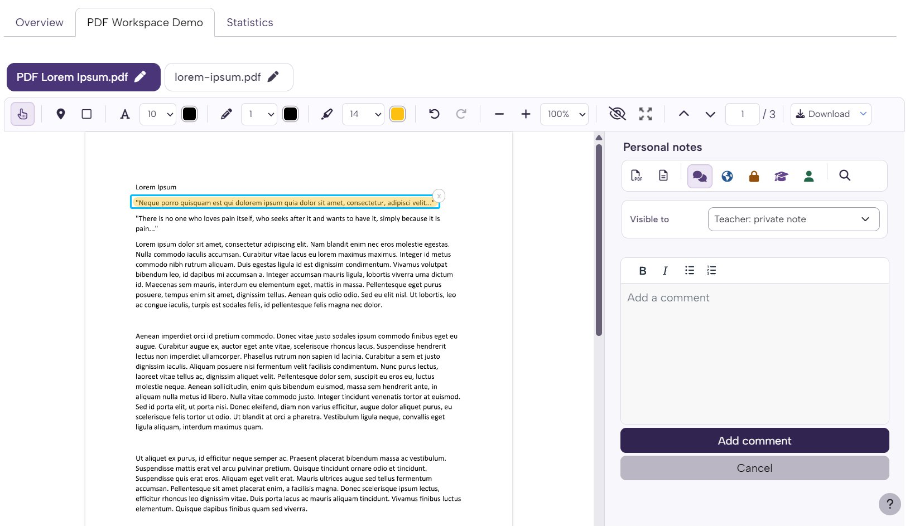
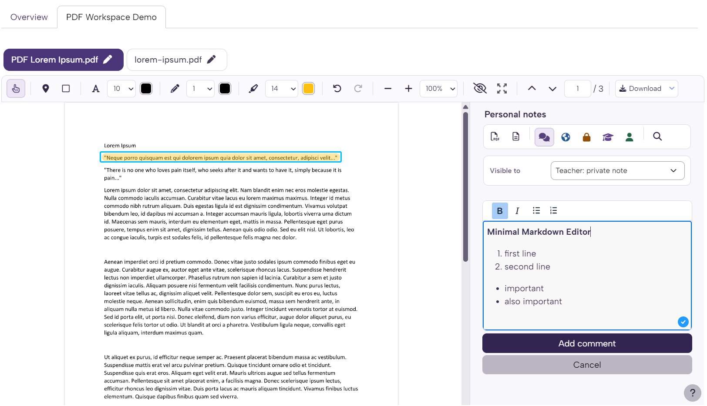
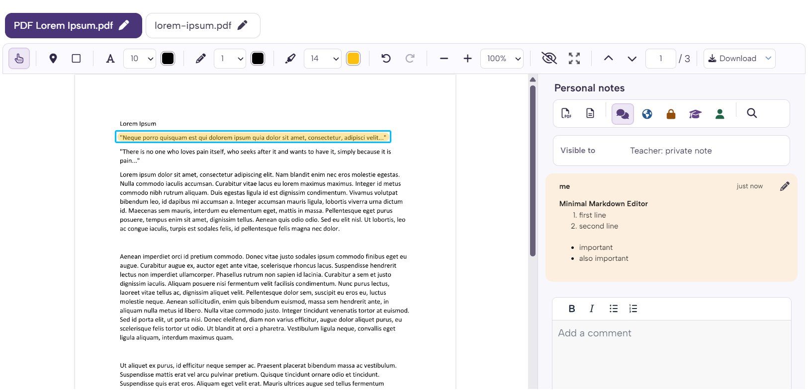
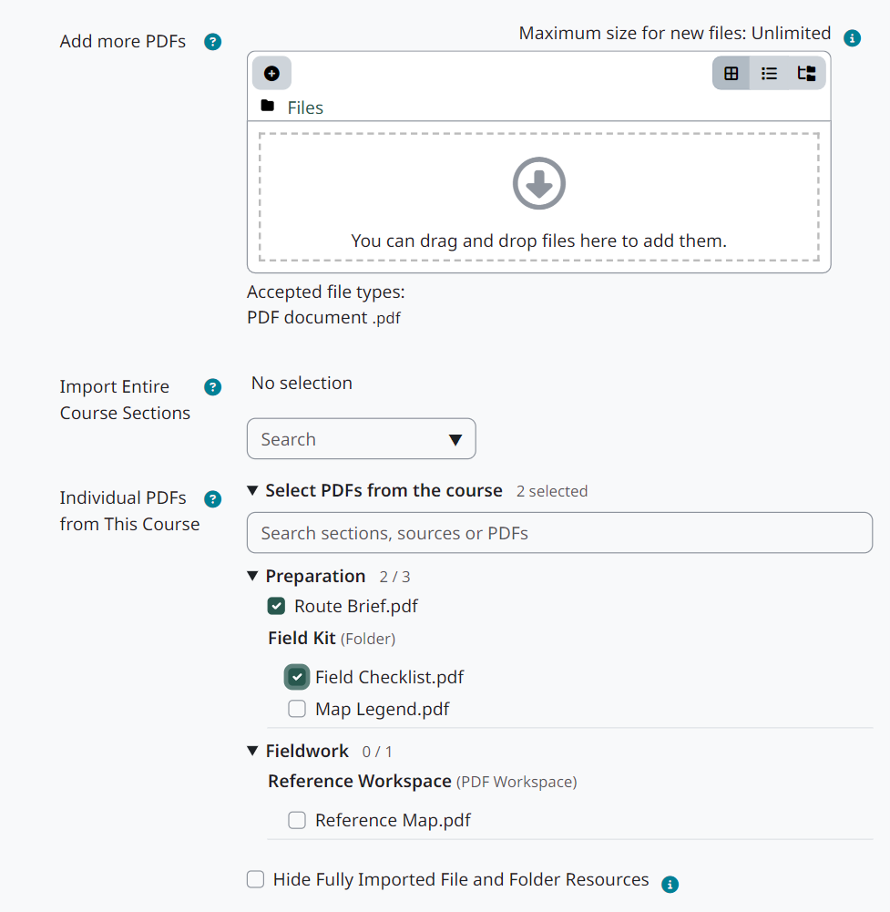
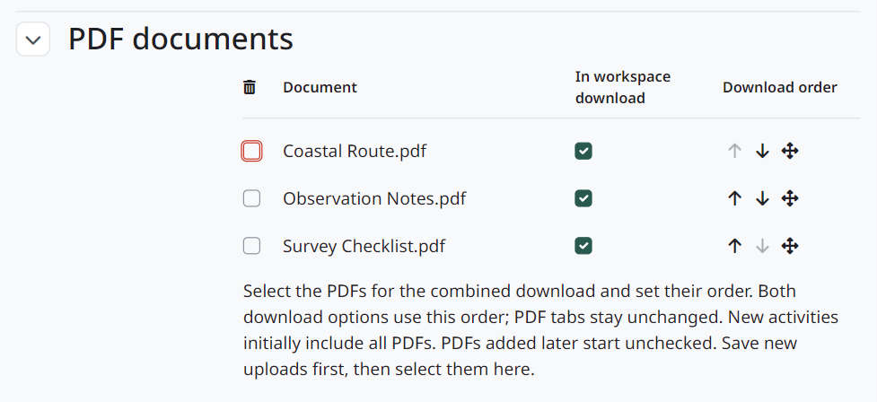
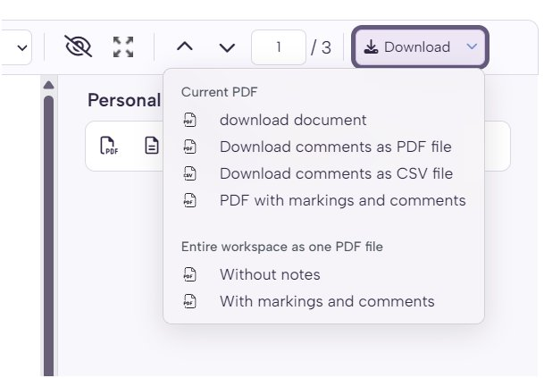
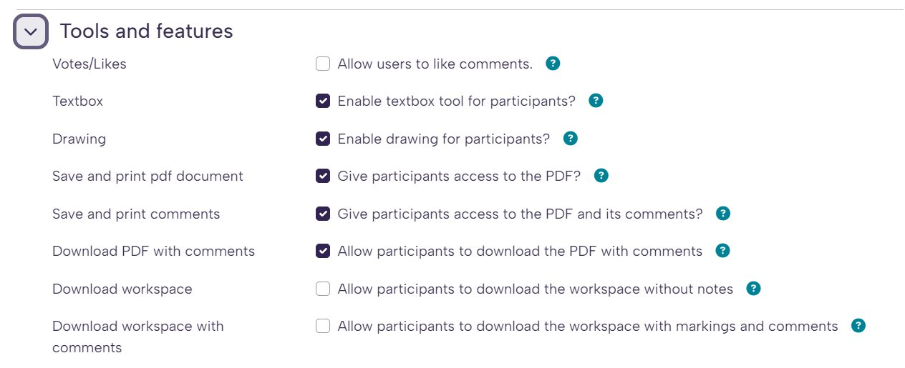
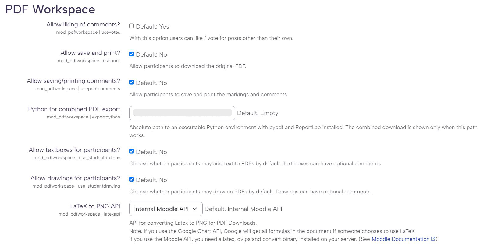

  

# PDF Workspace

Read, annotate and discuss PDFs within a Moodle course activity. Teachers can
bring several documents together in one workspace, and participants can add
markings and comments with the audiences allowed by the activity settings.

## Screenshots

View screenshots (9)

Click a preview to open the full-size screenshot.

<table>
<tr>
<td align="center" width="50%" valign="middle">
 
PDF tabs, annotation tools and highlighting
</td>
<td align="center" width="50%" valign="middle">
 
Add a comment to a PDF marking
</td>
</tr>
<tr>
<td align="center" width="50%" valign="middle">
 
Format comments with bold text and lists
</td>
<td align="center" width="50%" valign="middle">
 
Reply within a comment thread
</td>
</tr>
<tr>
<td align="center" width="50%" valign="middle">
 
Select several course PDFs in the activity settings
</td>
<td align="center" width="50%" valign="middle">
 
Manage saved PDFs as a site administrator. The red border marks a PDF with annotations.
</td>
</tr>
<tr>
<td align="center" width="50%" valign="middle">
 
Current PDF and workspace download options
</td>
<td align="center" width="50%" valign="middle">
 
Configure annotation tools and participant downloads
</td>
</tr>
<tr>
<td align="center" width="50%" valign="middle">
 
Site administration and combined-export settings
</td>
</tr>
</table>

## Features

- Multiple PDFs in one activity, with a tab for each document.
- Drawing, highlighting, text, pin and area markings, with optional comment threads.
- Configurable visibility for participant and staff annotations.
- An overview of questions, answers, your own posts and reports.
- Downloads of original PDFs, comments, annotated PDFs and selected workspace documents.

Supports Moodle 4.5, 5.0, 5.1, 5.2 and 5.3.

## Installation

1. Install the plugin as `mod/pdfworkspace` below Moodle's plugin directory.
2. Complete installation through **Site administration → Notifications**.
3. Add a **PDF Workspace** activity to a course. Upload PDFs or select them from the course.
4. Configure annotation audiences and the downloads available to participants.

For Moodle installations using the split web directory, the plugin belongs in
`public/mod/pdfworkspace`. See Moodle's
[plugin installation guide](https://docs.moodle.org/en/Installing_contributed_modules_or_plugins).

## Working with documents and comments

Choose a document tab, select an annotation tool and mark the PDF. A marking can
stand on its own or start a comment thread. The activity settings control which
audiences participants and staff may select. Replies keep the thread's audience.

Teachers with course editing permission can change the displayed document names.

### Restrict access to PDF originals

In the activity settings, add the files in the usual PDF upload field and select
**Protect All Newly Uploaded PDFs** before saving. The checkbox applies to all
new files in the current upload. Save regular and protected uploads separately.

Protected documents appear with a lock in the usual document tabs. Users can
annotate rendered pages and discuss those annotations in the same viewer.
Access to the original PDF requires a separate permission, independent of the
activity's regular download options. See the
[protected PDF setup](export/README.md#protected-pdf-setup) for permissions,
server configuration and backup guidance.

### Import PDFs from the course

In the activity settings, tick several PDFs under **Individual PDFs from This
Course**, or select one or more course sections to import all eligible PDFs in
them. The picker finds locally stored PDF files in visible File and Folder
resources and in other PDF Workspace activities in the same course. Sources and
their sections must be unrestricted and shown on the course page. For another
workspace, you also need permission to view it and manage its files. The import
copies the PDF. Its markings and discussions stay in the source workspace.

### Remove PDFs with markings or comments

Site administrators and users with editing rights and the **Remove PDFs with
markings and discussions** permission (`mod/pdfworkspace:deleteannotateddocument`)
can remove annotated PDFs in the activity settings. A red border identifies the
removal checkbox for a PDF with markings or comments. Tick the checkbox, choose
**Remove anyway**, then save the settings to remove the PDF and its markings and
discussions. At least one PDF must stay in the workspace.

## Finding questions and replies

The overview brings together questions, answers, your own posts and reported
comments across the workspace. Compact tables show the document first, followed
by a two-line comment preview and author details. Hover over a preview or focus
it with the keyboard to read the full text. Open a document, question or reply
link to jump directly to the corresponding PDF, marking and comment.

## Downloads and activity settings

The viewer's download menu separates the current PDF from the entire workspace.
Original PDFs and comments-only downloads are available separately from combined
PDFs containing visible markings and comments.

In the activity settings, use the PDF list to select documents for workspace
downloads and arrange their download order. This order is independent of the
viewer tabs. Initial PDFs are included; PDFs uploaded later start excluded and
can be selected after saving. Document names become bookmarks in the combined PDF.

The capabilities `mod/pdfworkspace:downloadworkspace` and
`mod/pdfworkspace:downloadworkspacecomments` control the two workspace download
variants independently. Participants also need the corresponding download option
enabled in the activity. Teachers with the corresponding permission can download
without that participant option; an explicit permission prohibition still applies.
Commented exports contain only markings and comments visible to the requesting user.

## Optional server components

### Poppler for protected PDFs

To add protected PDFs, install Poppler's `pdftoppm` on the Moodle server. Enter
its absolute path in **Site administration → Plugins → Activity modules →
PDF Workspace → PDF Renderer for Restricted Documents**. Moodle uses it to render
page images when a protected PDF is saved. See the setup steps in
[English](export/README.md#protected-pdf-setup) or
[German](export/README.de.md#geschützte-pdfs-einrichten).

### Server requirements for combined downloads

Combined PDF and workspace downloads additionally require **Python 3.11+ on the
Moodle server**, with **pypdf, ReportLab and cryptography for AES-encrypted PDFs**.
Install the pinned packages from [export/requirements.txt](export/requirements.txt)
in a separate virtual environment outside the public web directory, and configure
its interpreter in the PDF Workspace site-administration settings.

PHP must allow `proc_open` and access to the interpreter path. The Moodle service
account needs permission to run it. Python and these libraries are installed
separately and are not included in the plugin ZIP. The normal viewer, original-PDF
and comments-only downloads work without Python.

See [server setup in English](export/README.md) or
[Servereinrichtung auf Deutsch](export/README.de.md) for the complete instructions.

## Privacy

PDFs, markings, comment content and attachments are stored within Moodle,
with author and selected-recipient references, subscriptions, votes and reports.
The plugin supports Moodle Privacy API export and erasure. Combined downloads
are generated locally on the Moodle server and apply the requesting user's
visibility permissions.

## Maintainer and origin

PDF Workspace is an independently maintained derivative of RWTH Aachen's PDF
Annotator. Original authorship and copyright notices are retained.
Workspace changes are copyright 2026 Andreas Giesen <andreas@108design.com> (108design).
Maintained by Andreas Giesen.

## License

**Available free of charge under the terms of the applicable license.**

GNU General Public License version 3 or later. See [LICENSE.md](https://github.com/108design/moodle-mod_pdfworkspace/blob/main/LICENSE.md) for the full terms.
Bundled third-party code retains its original licences: MIT for pdf-annotate.js,
text-clipper and jsPDF; Apache 2.0 for PDF.js and its supporting assets.
See [thirdpartylibs.xml](thirdpartylibs.xml) and the bundled licence files for details.

This program is distributed in the hope that it will be useful,
but WITHOUT ANY WARRANTY; without even the implied warranty of
MERCHANTABILITY or FITNESS FOR A PARTICULAR PURPOSE.  See the
GNU General Public License for more details.
